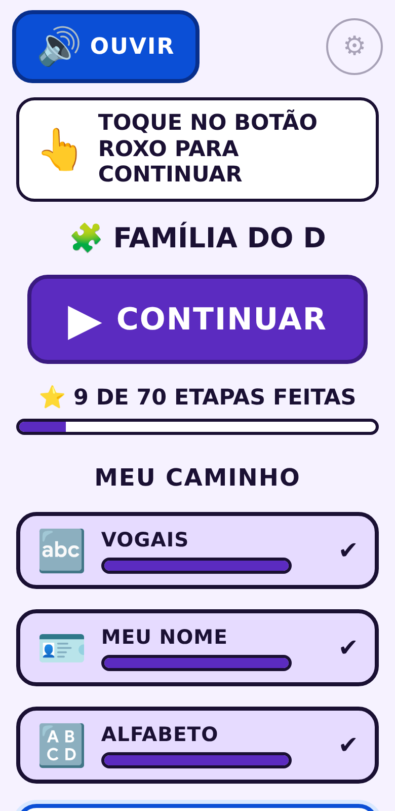
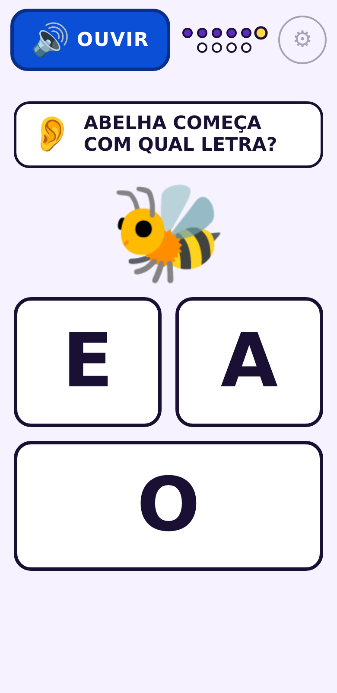
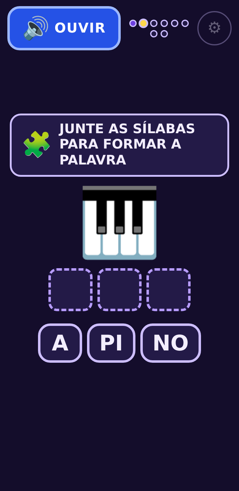
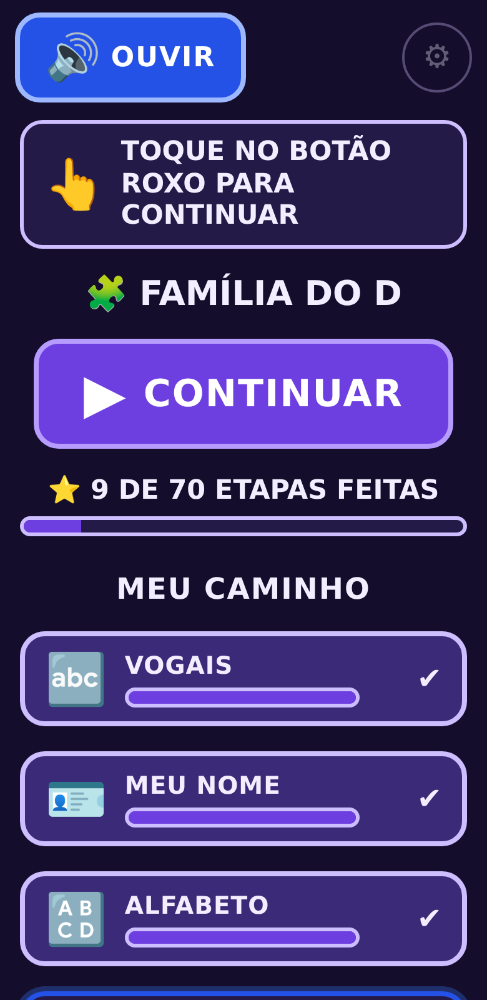

# Ler Livre

[](https://github.com/alini-x/ler-livre/actions/workflows/pages.yml) [](LICENSE)

**Aplicativo web gratuito para alfabetizar em português do Brasil, pelo celular, sem precisar ler para usar.**

Ler Livre é um PWA (aplicativo web instalável) feito com HTML, CSS e JavaScript puros. Ele guia a pessoa por uma trilha silábica inspirada nas palavras geradoras de Paulo Freire: toda instrução tem voz, imagem e texto, os botões são grandes e errar nunca tem punição.

> *In English:* Ler Livre is a free, offline-capable web app that teaches Brazilian Portuguese literacy to anyone who cannot yet read, at any age. Every instruction is spoken (browser speech synthesis) and illustrated, there are no accounts, ads or tracking, and all progress stays on the device. Pure HTML/CSS/JS, no build step. MIT licensed.

**Sobre o nome.** *Ler* é o verbo central do projeto; *livre* tem dois sentidos que importam aqui: a liberdade e a autonomia que a leitura traz, e um app gratuito, sem anúncios nem conta.

**Status:** versão 0.1.0, em desenvolvimento aberto. Testado no computador e num celular Android (Motorola Edge 60, Chrome); ainda **sem uso real** com quem vai aprender. Veja o [CHANGELOG](CHANGELOG.md).

**Usar agora:** [alini-x.github.io/ler-livre](https://alini-x.github.io/ler-livre/) (no Chrome do Android, menu ⋮ → *Instalar app*).

<p align="center">
  
  
  
  
</p>

## Para quem é

Para qualquer pessoa que ainda não sabe ler e escrever, de qualquer idade, e quer aprender sozinha, no próprio celular e no próprio ritmo. A **mediadora** (um familiar, voluntário ou educador) só acompanha: cadastra o nome e as palavras da vida da pessoa e vê o progresso quando quiser.

## Por que existe

O projeto nasceu do desejo de ajudar uma pessoa próxima a aprender a ler com autonomia. Antes de criar algo novo, testamos vários aplicativos de alfabetização. Para quem não lê, o que impediu o uso não foi o conteúdo, e sim o caminho até ele:

| O que encontramos | Por que impede | Como o Ler Livre resolve |
|---|---|---|
| Propagandas no meio do uso | Quem não lê não distingue o anúncio da atividade nem acha como sair | Nenhum anúncio |
| Cadastro e login antes de começar | Exige ler e digitar antes de aprender qualquer coisa | Sem conta: abre e começa. O cadastro do nome e das palavras é da mediadora, em área separada |
| Instruções só em texto, ou sem áudio | Quem não lê não sabe o que fazer | Toda tela fala, e o botão "ouvir de novo" fica sempre visível |

A partir disso, o app segue quatro regras:

- Toda instrução tem voz, imagem e texto em letras maiúsculas de imprensa.
- Errar não tem punição: o áudio se repete, vem uma dica e a pessoa tenta de novo.
- Sem anúncios, conta ou rastreamento, e sem IA ou serviço externo enquanto o app roda. Progresso e dados ficam só no aparelho.
- Funciona offline depois da primeira abertura e pode ser instalado na tela inicial.

## Como o app foi pensado

A principal inspiração é Paulo Freire, combinada com práticas de alfabetização em português. É um projeto em construção, **ainda não validado por educadores nem por pesquisa**: ele apoia quem alfabetiza, não o substitui.

**Esperança como ação.** Em *Pedagogia da Esperança* (FREIRE, 1992), Freire diz que a esperança "precisa da prática para tornar-se concretude histórica": "não há esperança na pura espera". Foi isso que nos motivou: em vez de esperar que outra pessoa ou outro aplicativo resolvesse, construir algo que ajude a pessoa a dar o próximo passo.

**Autonomia com diálogo.** Para Freire, "ninguém educa a si mesmo, os homens se educam entre si, mediatizados pelo mundo" (FREIRE, 1974). Aqui, aprender sozinha significa usar o app no próprio ritmo, sem isolamento: a mediadora conversa com a pessoa, escolhe as palavras e acompanha. Há o risco de uma trilha pronta virar uma "cartilha digital", a educação "bancária" que Freire criticava. Entendemos que a tecnologia não é o problema em si; o que importa é quem fica no controle. No Ler Livre, a pessoa monta e descobre palavras, repete o que quiser, pode pular o que já sabe e trabalha com palavras da vida dela. A voz, a repetição sem cansaço e o uso offline dão autonomia sem depender de outra pessoa a cada passo. Com a evolução da tecnologia, a ideia é ampliar essa autonomia, sem abrir mão da privacidade e da aprovação humana.

**De Freire, usamos:**
- A leitura do mundo antes da leitura da palavra (FREIRE, 1982): o nome entra na etapa 2, e as palavras da pessoa aparecem como exemplos nas famílias silábicas.
- As palavras geradoras (FREIRE, 1967): uma palavra com figura, quebrada em sílabas, serve para descobrir e criar palavras novas, como nas fichas de descoberta do método. TIJOLO, o exemplo clássico, está no vocabulário.

**Da alfabetização em português, usamos:**
- Famílias silábicas, das sílabas simples (BA-BE-BI-BO-BU) a CH, LH, NH, RR, SS, Ç, encontros consonantais, ditongos e finais, com dificuldade crescente.
- Letra de imprensa maiúscula no início, e atividades de ouvir, ver, tocar, montar e traçar.
- Avanço com 80% de acerto de primeira, com teste opcional para pular etapas.
- Do letramento (SOARES, 2003): chegar a frases, leitura em voz alta e ditado, com palavras que fazem sentido para a pessoa.

## Referências

ANDRADE, Paulo Estevão; ANDRADE, Olga Valéria Campana dos Anjos; PRADO, Paulo Sérgio T. do. Psicogênese da língua escrita: uma análise necessária. *Cadernos de Pesquisa*, 2017.

BRASIL. Ministério da Educação. Secretaria de Alfabetização. *Relatório Nacional da Alfabetização Baseada em Evidências (RENABE)*. 2021.

FERREIRO, Emilia; TEBEROSKY, Ana. *Psicogênese da língua escrita*. Artes Médicas, 1985. (Original: *Los sistemas de escritura en el desarrollo del niño*. Siglo XXI, 1979.)

FREIRE, Paulo. *Educação como prática da liberdade*. Paz e Terra, 1967.

FREIRE, Paulo. *Pedagogia do oprimido*. Paz e Terra, 1974. (Escrita em 1968.)

FREIRE, Paulo. *A importância do ato de ler: em três artigos que se completam*. São Paulo: Autores Associados; Cortez, 1982.

FREIRE, Paulo. *Pedagogia da esperança: um reencontro com a Pedagogia do oprimido*. Rio de Janeiro: Paz e Terra, 1992.

SOARES, Magda. *Alfabetização e letramento*. São Paulo: Contexto, 2003.

SOARES, Magda. *Alfabetização: a questão dos métodos*. São Paulo: Contexto, 2016.

## O que o app faz

- **Trilha de 70 etapas**, em 8 grupos: vogais, meu nome, alfabeto, sílabas, montar palavras, palavras da vida, frases e ler e escrever. As sílabas vão de B, C, D... até CH, LH, NH, RR, Ç, encontros (BR, PL...), ditongos, finais (R, L, S, M, N) e til.
- **Atividades**: olhar e ouvir, ouvir e tocar, montar com letras ou sílabas, ordenar frases, criar palavras novas, traçar letras com o dedo, ler em voz alta e ditado.
- **Vocabulário escalável**: 237 palavras com sílabas e figura (emoji). Uma palavra só aparece depois que **todas as suas sílabas** foram ensinadas.
- **Sem becos sem saída**: o botão 🏠 volta ao início em qualquer tela, o botão Voltar do Android também, e depois de várias tentativas sem acertar aparece "PULAR". Só a mediadora, com confirmação, apaga o progresso.
- **Progresso visível**: a tela inicial mostra o botão principal, a barra geral e "Meu caminho" com os 8 grupos. Etapas feitas podem ser repetidas.
- **Teste para pular etapas**: tocar numa etapa que ainda não chegou oferece um teste curto; com 80% de acerto de primeira, as etapas anteriores contam como feitas.
- **Tema roxo e azul**, claro e escuro automáticos conforme o aparelho (contraste mínimo de 6:1), com opção de forçar um deles.
- **Área da mediadora** (botão ⚙ discreto, sem senha): cadastrar o nome e como ele deve ser falado, manter a lista de palavras da pessoa (com sílabas, figura, frase e aprovação), importar palavras por arquivo, ver onde a pessoa mais errou, exportar o progresso, ir direto a qualquer etapa para testar, ajustar velocidade da voz e tema e zerar o progresso.

## Como testar no computador

Precisa de Python 3 e de um navegador. Para ouvir a voz, no Linux o Chromium e o Brave precisam da opção `--enable-speech-dispatcher`; o script abaixo já cuida disso.

```bash
./testar.sh
```

Variantes: `./testar.sh brave` e `./testar.sh firefox`. Sem o script, qualquer servidor estático serve, por exemplo `python3 -m http.server 8000` e abrir `http://localhost:8000` (localhost conta como HTTPS para o service worker).

### Testar no celular pelo mesmo Wi-Fi

```bash
./testar-celular.sh
```

O script mostra o endereço (por exemplo, `http://192.168.0.81:8000/index.html`) para abrir no Chrome do celular. Cada acesso aparece no terminal, o que confirma que o celular chegou. Como é HTTP e não HTTPS, o celular **não registra o service worker**: dá para validar telas, toque, voz, progresso e a área da mediadora, mas **não** o modo offline nem a instalação. Para isso, use o app publicado no GitHub Pages (HTTPS). Só para testes, no Chrome do Android é possível liberar o endereço em `chrome://flags/#unsafely-treat-insecure-origin-as-secure` (informe o endereço do script e reinicie o Chrome); desfaça depois.

Na primeira abertura, abra o ⚙, cadastre o nome e algumas palavras aprovadas. Use "Ir para uma etapa" para ver qualquer parte da trilha.

## Publicar

O service worker (modo offline e instalação) exige HTTPS, que o GitHub Pages oferece de graça. O fluxo `.github/workflows/pages.yml` publica a cada push na `main`. Checklist e passo a passo (do repositório à instalação no celular): [docs/publicacao.md](docs/publicacao.md).

## Som (voz)

O app usa a voz do próprio aparelho (`speechSynthesis`), sem arquivos de áudio; por isso o primeiro teste deve ser no celular de quem vai usar. Cada voz fala de um jeito (algumas soletram sílabas acentuadas), então em ⚙ → *Pronúncia de letras e sílabas* a mediadora escolhe o estilo das sílabas, ouve exemplos e ajusta item a item, só naquele aparelho. Sem voz em português, aparece um aviso amarelo; a primeira fala só sai após o primeiro toque (regra dos navegadores).

## Requisitos

Aparelho de referência: Motorola Edge 60 (Android 15), no Chrome. As figuras (emojis) aparecem todas no **Android 14 ou mais**; o mínimo técnico é o Chrome 86; o aparelho precisa de voz em português do Brasil. Detalhes em [docs/requisitos.md](docs/requisitos.md).

## Estrutura do projeto

```
index.html, manifest.webmanifest, sw.js   o app, a instalação e o modo offline
css/estilo.css                            tema claro/escuro (variáveis no topo)
js/app.js                                 trilha, telas e atividades
js/voz.js                                 falar(texto) e a escolha da voz
js/dom.js                                 criação de elementos sem innerHTML (usada pelas telas)
js/db.js                                  progresso e dados no aparelho (IndexedDB)
js/mediadora.js                           área da mediadora
conteudo/                                 todo o conteúdo em JSON (vocabulário, frases, etapas)
ferramentas/                              gerador da trilha, validador do vocabulário, capturas de tela
tests/                                    testes automatizados (unitários e de ponta a ponta)
docs/                                     decisões de arquitetura, requisitos e guia de publicação
.github/                                  CI, publicação no Pages, Dependabot, modelos de issue e de PR
testar.sh                                 abre o app no navegador com voz, para testes locais
testar-celular.sh                         serve o app na rede local, para testar no celular pelo Wi-Fi
```

## Privacidade e segurança

Nenhum dado sai do aparelho, a não ser que a mediadora exporte o progresso ou importe palavras por arquivo. O app não faz chamadas externas e roda com uma política de segurança restritiva (CSP). A área da mediadora não tem senha, de propósito. Modelo de ameaças, riscos aceitos e como reportar problemas: [SECURITY.md](SECURITY.md).

## Limitações e próximos passos

- O app foi testado num celular Android (Motorola Edge 60, Chrome) durante o desenvolvimento; falta o uso real com quem vai aprender e em outros aparelhos.
- A proposta pedagógica **não foi validada** por educadores nem por pesquisa, e não se apoia em estudos recentes de eficácia dos métodos (por exemplo, BRASIL, 2021). Comparar a trilha com essa literatura é um passo pendente.
- A trilha é silábica, método criticado no debate sobre alfabetização por associar sons a estímulos gráficos (ANDRADE; ANDRADE; PRADO, 2017; FERREIRO; TEBEROSKY, 1985; ver também SOARES, 2016). O risco de virar treino mecânico é tratado com erro sem punição, palavras formadas pela própria pessoa e palavras da vida dela.
- A etapa "Palavras da vida" está perto do fim da trilha (etapa 60 de 70); deve ser antecipada para partir das palavras da pessoa.
- A voz depende do aparelho e pode soar robótica ou errar sílabas.
- As figuras são emojis, que variam entre aparelhos; figuras próprias e fotos da pessoa ainda não são suportadas.
- O traçar conta como feito com 60% de cobertura da letra; o limite pode precisar de ajuste.
- O teste de ponta a ponta ainda não roda no CI.

## Documentação e contribuição

- [CONTRIBUTING.md](CONTRIBUTING.md) e [CODE_OF_CONDUCT.md](CODE_OF_CONDUCT.md): como contribuir. Relatos de testes com pessoas reais, palavras e correções de pronúncia são especialmente bem-vindos.
- [docs/decisoes.md](docs/decisoes.md): decisões de arquitetura.
- [docs/requisitos.md](docs/requisitos.md) e [docs/publicacao.md](docs/publicacao.md): requisitos e publicação.
- [SECURITY.md](SECURITY.md): segurança.

## Licença

[MIT](LICENSE).
